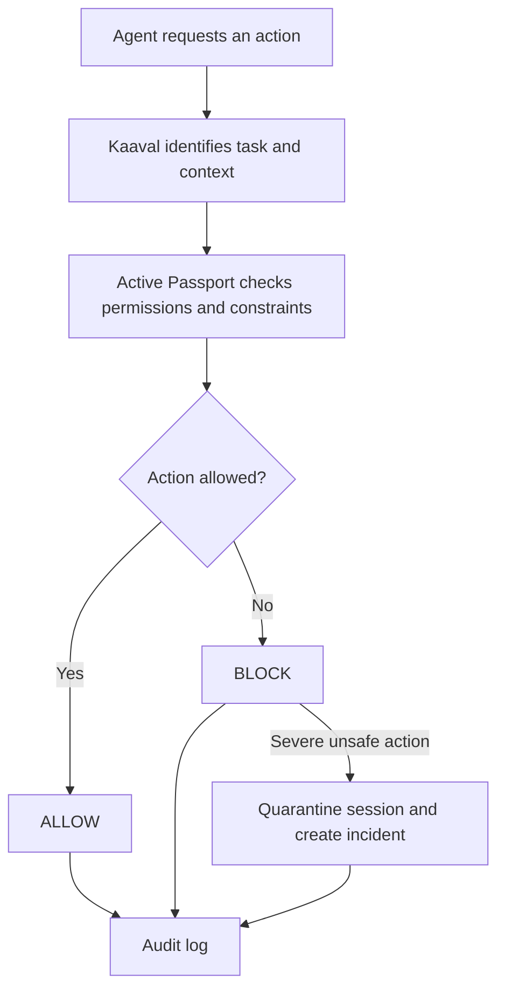
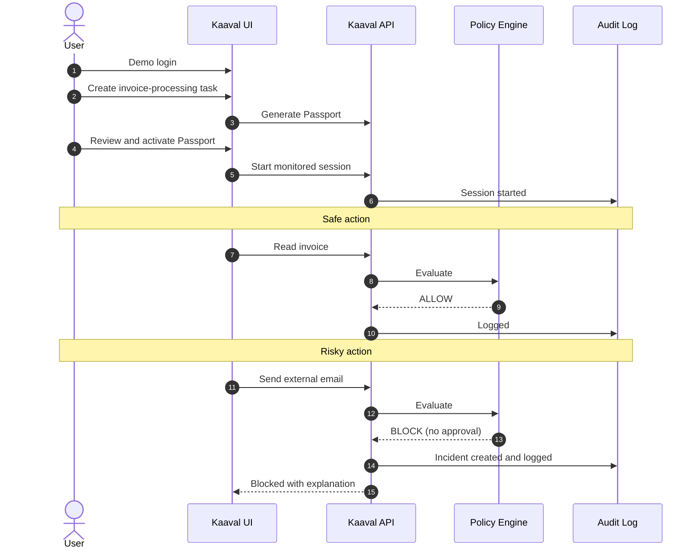
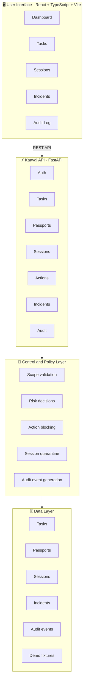
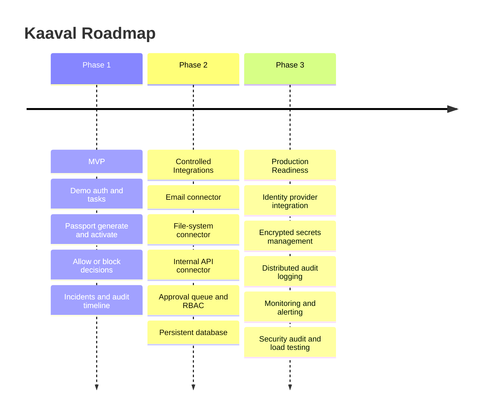

<div align="center">

# 🛡️ Kaaval

### Safety, Control & Audit Platform for Autonomous AI Agents

*Kaaval (ಕಾವಲ್) means "guard" — it stands watch between your AI agents and the systems they can touch.*

<br/>


<br/>

> **Kaaval does not blindly trust an AI agent.**
> **It verifies every important action *before* execution.**

<br/>

[The Problem](#-the-problem) •
[How It Works](#-how-it-works) •
[Features](#-features) •
[Demo](#-demo-scenario) •
[Quick Start](#-quick-start) •
[API](#-api-overview) •
[Roadmap](#-roadmap)

</div>

---

## 🚨 The Problem

Autonomous AI agents can now read email, open files, call APIs, and operate business applications with very little human supervision. That power comes with risk. A single unexpected action can:

- 🔓 Expose sensitive information
- ✉️ Send an unauthorized message
- 🗑️ Modify or delete important records
- 💸 Trigger an irreversible business operation
- ⚖️ Create compliance and accountability problems

Traditional monitoring tells you **what happened after the damage is done**.
Kaaval **controls the action before it causes harm.**

---

## 💡 How It Works

Kaaval places a controlled execution layer between an AI agent and the systems it can access. Nothing runs until Kaaval has checked it against the task's **Passport**.



### MVP enforcement outcomes

| Decision | Meaning | What happens next |
|:--|:--|:--|
| ✅ **`ALLOW`** | The synthetic invoice read is within the active Passport | The fixture-backed mock tool runs and the decision is audited |
| ⛔ **`BLOCK`** | The action is outside the current Passport or MVP policy | Denied and audited; severe unsafe actions can quarantine the session and create an incident |

Human approval and escalation are roadmap items, not implemented MVP outcomes.

---

## ✨ Features

<table>
<tr>
<td width="50%" valign="top">

### 🗂️ Agent & Task Management
- Create and inspect agent tasks
- View task status and metadata
- Track the current execution session
- Display the agent's intended action

### 🛂 Passport-Based Control
The invoice-demo Passport is generated by the backend and must be reviewed and
activated before a session can act. In the current deterministic MVP, it allows
`read_invoice` and forbids `send_email` and `delete_backup`; configurable
approvals, resources, and policy authoring are not implemented.

### ⚙️ Action Decision Engine
Evaluates each requested action and returns a backend decision with a
human-readable reason. The current MVP allows the synthetic invoice fixture
read and blocks unsupported, external-communication, or destructive actions.

</td>
<td width="50%" valign="top">

### 📡 Session Monitoring
- Backend session state and persisted timeline
- Submitted synthetic actions and backend decisions
- Reasons for blocked actions
- Quarantine and incident events

### 🚑 Incident Management
Severe unsafe actions can quarantine the session and create an incident with
the summary and containment status exposed by the backend. Raw action payloads
and some forensic details are not exposed by the current API.

### 📜 Audit Trail
Every important event is recorded: task creation, Passport generation and activation, session start, action requests, allow/block decisions, escalations, quarantines, and incidents.

</td>
</tr>
</table>

---

## 🎬 Demo Scenario

The MVP shows an AI agent processing an **invoice workflow**.

<table>
<tr>
<th width="50%">✅ Allowed actions</th>
<th width="50%">⛔ Blocked actions</th>
</tr>
<tr>
<td valign="top">

- Read the allowlisted synthetic invoice fixture

</td>
<td valign="top">

- Attempt a simulated external email (`send_email`)
- Attempt a simulated destructive action (`delete_backup`)
- Use tools that are unsupported by the current Passport

All tools in this MVP are synthetic: no real email is sent and no real data is
deleted or transmitted.

</td>
</tr>
</table>

### Demo flow



---

## 🏗️ Architecture



### Tech stack

| Layer | Technologies |
|:--|:--|
| **Frontend** | React · TypeScript · Vite · responsive UI · REST integration |
| **Backend** | Python · FastAPI · Pydantic · RESTful API · CORS |
| **Tooling** | Git · GitHub · VS Code · npm · Uvicorn |

<details>
<summary><b>📁 Project structure</b></summary>

```text
kaaval/
├── backend/
│   ├── app/
│   │   ├── api/
│   │   ├── core/
│   │   ├── models/
│   │   ├── services/
│   │   └── main.py
│   ├── tests/
│   ├── pyproject.toml
│   └── README.md
│
├── frontend/
│   ├── public/
│   ├── src/
│   │   ├── components/
│   │   ├── pages/
│   │   ├── services/
│   │   ├── types/
│   │   └── App.tsx
│   ├── package.json
│   ├── vite.config.ts
│   └── .env.example
│
├── docs/
│   ├── architecture.md
│   ├── api.md
│   └── demo-script.md
│
├── fixtures/
│   └── demo-data/
│
├── .gitignore
└── README.md
```

</details>

---

## 🚀 Quick Start

### Prerequisites

| Tool | Version |
|:--|:--|
| Node.js | 20 or later |
| npm | bundled with Node |
| Python | 3.11 or later |
| Git | any recent version |

```bash
node --version && npm --version && python --version && git --version
```

### 1️⃣ Clone the repository

```bash
git clone https://github.com/YOUR_USERNAME/kaaval.git
cd kaaval
```

### 2️⃣ Start the backend

<details open>
<summary><b>🪟 Windows (PowerShell)</b></summary>

```powershell
cd backend
python -m venv .venv
.venv\Scripts\Activate.ps1
pip install -r requirements.txt
uvicorn app.main:app --reload
```

</details>

<details>
<summary><b>🍎 macOS / 🐧 Linux</b></summary>

```bash
cd backend
python3 -m venv .venv
source .venv/bin/activate
pip install -r requirements.txt
uvicorn app.main:app --reload
```

</details>

| Service | URL |
|:--|:--|
| Backend | http://localhost:8000 |
| Interactive API docs | http://localhost:8000/docs |

### 3️⃣ Start the frontend

Open a **second terminal**:

```bash
cd frontend
npm install
```

Create your local environment file:

```bash
# macOS / Linux
cp .env.example .env.local

# Windows PowerShell
Copy-Item .env.example .env.local
```

Point it at the backend in `frontend/.env.local`:

```env
VITE_API_BASE_URL=http://localhost:8000
```

Then run:

```bash
npm run dev
```

🎉 Open **http://localhost:5173** and click through the demo login.

> ⚠️ Never commit `.env.local`.

To verify the frontend type-check and production bundle, run `npm run lint`
and `npm run build` from `frontend/`.

---

## 🔌 API Overview

The full contract is always available live at **`/docs`** (FastAPI's Swagger UI). Exact endpoint names may vary with the current backend implementation.

<details>
<summary><b>🔐 Authentication</b></summary>

```text
POST /api/auth/demo-login
GET  /api/auth/me
POST /api/auth/logout
```

</details>

<details>
<summary><b>📋 Tasks</b></summary>

```text
POST /api/tasks
GET  /api/tasks
GET  /api/tasks/{task_id}
```

</details>

<details>
<summary><b>🛂 Passports</b></summary>

```text
POST /api/tasks/{task_id}/passport/generate
GET  /api/tasks/{task_id}/passport
POST /api/tasks/{task_id}/passport/activate
```

</details>

<details>
<summary><b>📡 Sessions and Actions</b></summary>

```text
POST /api/sessions
GET  /api/sessions/{session_id}
GET  /api/sessions/{session_id}/timeline
POST /api/sessions/{session_id}/actions
```

</details>

<details>
<summary><b>🚑 Incidents and Audit</b></summary>

```text
GET /api/incidents
GET /api/incidents/{incident_id}
GET /api/audit
```

</details>

---

## 🗺️ Roadmap



<details>
<summary><b>📌 Detailed checklist</b></summary>

#### Phase 1 · MVP
- [x] Frontend interface and backend API foundation
- [x] Demo authentication and task creation
- [x] Passport generation, review, and activation
- [x] Session monitoring and allow/block action decisions
- [x] Incident creation and audit timeline
- [x] Frontend GitHub Actions build check
- [x] `main` branch protection requiring pull requests and the `build` check
- [x] Browser-tested end-to-end demo flow
- [ ] Record and publish a short MVP demo

#### Phase 2 · Controlled Integrations
- [ ] Email connector
- [ ] File-system connector
- [ ] Internal API connector
- [ ] Approval queue
- [ ] Role-based access control
- [ ] Persistent database
- [ ] Policy version history
- [ ] Signed and versioned Passports

#### Phase 3 · Production Readiness
- [ ] Secure identity provider integration
- [ ] Encrypted secrets management
- [ ] Tamper-resistant, distributed audit logging
- [ ] Monitoring and alerting
- [ ] Rate limiting
- [ ] Deployment pipeline
- [ ] Security audit and penetration testing
- [ ] Load testing
- [ ] Disaster recovery plan

</details>

---

## 🧭 Why Kaaval Matters

> **AI agents should be useful without becoming uncontrollable.**

Instead of letting an agent execute everything it asks for, Kaaval adds:

- 🧱 **Explicit operational boundaries** through Passports
- 🧠 **Context-aware evaluation** of every important action
- 🙋 **Human oversight** for sensitive operations
- ⛔ **Immediate blocking** of unauthorized behavior
- 📜 **Transparent records** of every intervention

The result: autonomous workflows that are more observable, accountable, and safe to operate.

---

<div align="center">

<br/>

**Built with 🛡️ to keep AI agents accountable.**

*If Kaaval helped or inspired you, consider giving the repo a ⭐*

</div>